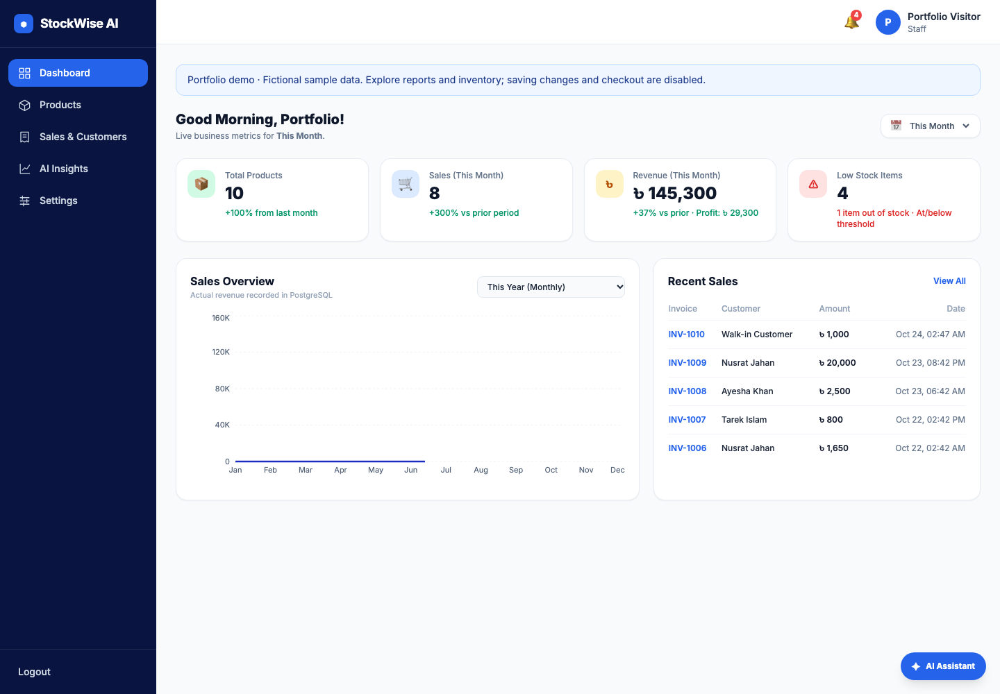
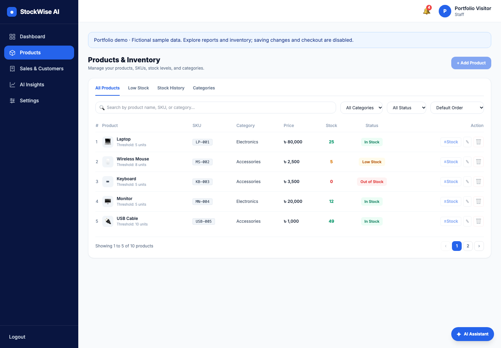
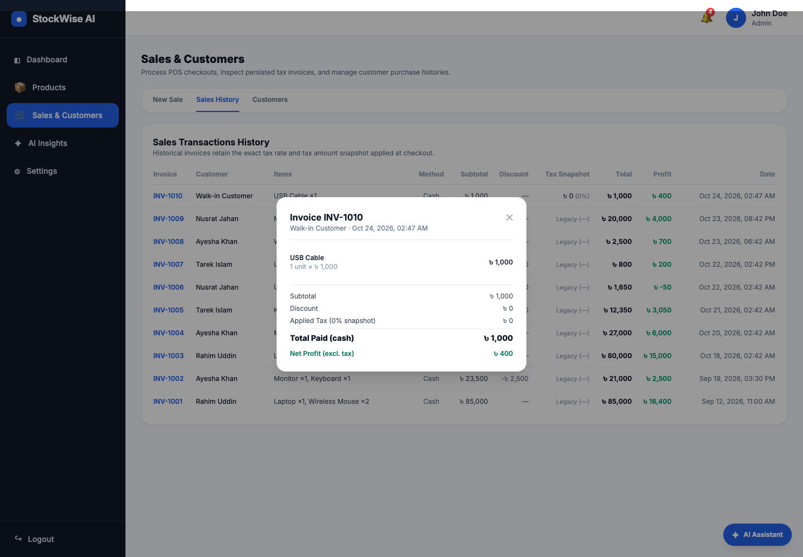
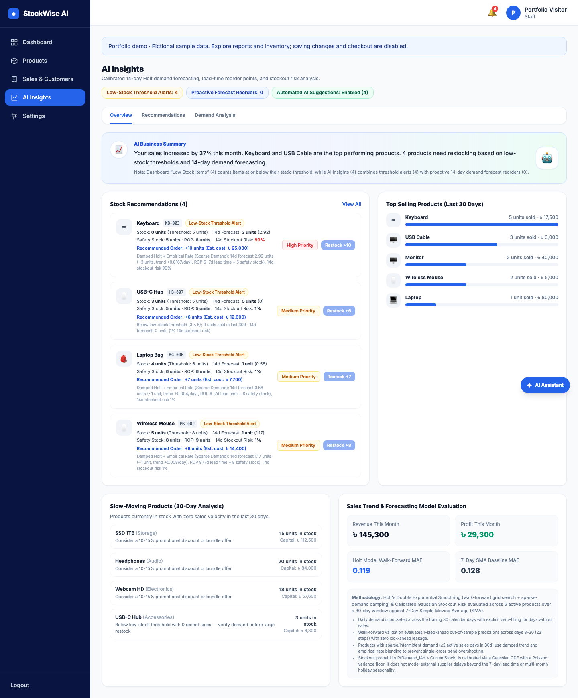
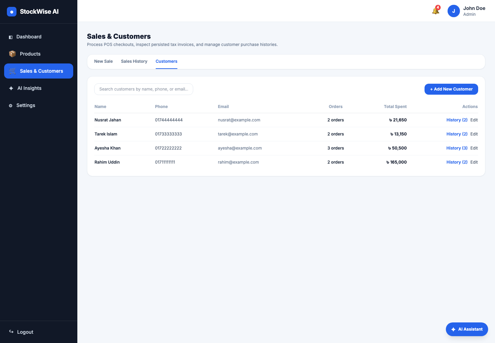

# StockWise AI — Smart Inventory & Sales Management System

> Full-stack inventory, POS checkout, customer tracking, calibrated time-series demand forecasting, and PostgreSQL-grounded AI Business Assistant built with React, Node.js/Express, PostgreSQL, and Prisma ORM.

**Repository:** [https://github.com/golammoula287/stockwise-ai](https://github.com/golammoula287/stockwise-ai)

---

## Overview & Key Features

### Unified Application Navigation (Route-Split with `React.lazy` & `Suspense`)
1. **Home (`/`) — Public:** Overview of core capabilities, interactive preview cards, Features, About, and Administrator Contact form.
2. **Login (`/login`) — Public:** JWT email/password authentication with login rate limiting, input validation, password visibility toggle, and Google Identity Services sign-in for invited accounts when GOOGLE_CLIENT_ID is configured.
3. **Dashboard (`/dashboard`) — Protected:** KPI summary cards (`Total Products`, `Sales`, `Revenue & Profit`, `Low Stock Items`), lazy-loaded `Sales Overview` area chart (`Recharts`) with `This Year` (monthly) and `Last 30 Days` (3-day interval) views, live date range filters (`This Month`, `Last 30 Days`, `Last 7 Days`, `Today`, `All Time`), preference-aware low-stock alert bell, and `Recent Sales` table.
4. **Products & Inventory (`/products`) — Protected:** Paginated product catalog with unique `SKU` badges, search (by name, SKU, or category), category/status/sort filters, `Low Stock` filter tab, `Stock History` audit ledger tab, `Categories` valuation tab, Product CRUD modal (`Admin`), and atomic integer stock adjustment modal (`±Stock`, `Admin`).
5. **Sales & Customers (`/sales`) — Protected (Unified Navigation):** Single unified page with query-synchronized tabs (`/sales?tab=new`, `/sales?tab=history`, `/sales?tab=customers`; `/customers` redirects cleanly to `/sales?tab=customers`):
   - **New Sale (`?tab=new`):** Three-column POS checkout with cart management, automatic stock deduction, persisted Business Settings tax snapshot (`taxRate` & `taxAmount`), payment method selection (`Cash`, `Card`, `bKash`, `Other`), and walk-in default reset after checkout.
   - **Sales History (`?tab=history`):** Complete invoice ledger with persisted tax snapshot badges and interactive Invoice Detail Modal.
   - **Customers (`?tab=customers`):** Customer CRUD, search, reconciled order/spending totals, and full purchase history inspection.
6. **AI Insights (`/ai-insights`) — Protected:** Calibrated 14-day demand forecasting (`Holt's Double Exponential Smoothing` with sparse-demand damping), explicit separation of `Low-Stock Threshold Alerts` vs. `Proactive Forecast Reorders` vs. `Automated AI Suggestions` state, 7-day lead-time Reorder Point (`ROP`) & 95% service-level safety stock, calibrated Gaussian stockout risk $P(D_{14} > \text{stock})$, slow-moving inventory capital detection, and walk-forward model evaluation (`MAE` & `RMSE` vs. 7-day SMA baseline).
7. **Settings (`/settings`) — Protected:** Profile management with unique email & phone validation, business configuration (`Business Name`, `Currency`, `POS Sales Tax Rate %`, `Default Low-Stock Threshold`), password update with current-password verification and session token refresh, and active system preferences (`Low-Stock Alert Notifications`, `Automated AI Reorder Suggestions`).
8. **Floating StockWise AI Business Assistant (`AIChatbot`):** Accessible across all authenticated pages at the bottom-right corner. Answers English and Bangla questions about live sales, revenue, profit, low-stock items, customer histories, specific invoices (`INV-XXXX`), tax calculation, and 14-day Holt demand forecasts using 12 strictly read-only PostgreSQL tools.

---

## AI Business Assistant Setup & Provider Configuration

The chatbot backend (`server/utils/aiChatbot.js` and `server/utils/chatTools.js`) keeps all LLM credentials strictly server-side and never bundles any AI SDK into the frontend.

### Groq configuration (`server/.env`)
```env
AI_API_KEY=your_groq_api_key
AI_MODEL=openai/gpt-oss-20b
AI_BASE_URL=https://api.groq.com/openai/v1
AI_PROVIDER_TIMEOUT_MS=30000
CHAT_RATE_LIMIT_MAX=30
```
The existing Chat Completions integration uses Groq's compatible endpoint and approved local read-only tools. Choose a tool-capable model available in your Groq account. See [Groq documentation](https://console.groq.com/docs/tool-use/overview). The key remains on the server. An empty key keeps the assistant visibly unconfigured (503); inventory forecasting remains available without an LLM.

See [local setup](docs/local-setup.md) for Neon configuration, migrations, safe seeding, and tests.

### Approved Read-Only Business Data Tools (`server/utils/chatTools.js`)
1. `get_dashboard_kpis` — Period-filtered KPIs (`today`, `last_7_days`, `last_30_days`, `this_month`, `all_time`).
2. `get_sales_by_date_range` — Completed order count, subtotal, discount, collected tax, revenue, profit, and recent invoices.
3. `get_revenue_and_profit` — Revenue, net profit (excluding collected tax), tax collected, and period-over-period change.
4. `get_products_inventory` — Search/filter products by name, SKU, category, or stock status.
5. `get_low_and_out_of_stock` — Lists all out-of-stock (`0 units`) and running-low (`<= threshold`) products.
6. `get_top_selling_products` — 30-day top sellers by units and revenue plus slow-moving inventory.
7. `get_customer_summaries` — Top customers by total spending and order count (with role-based phone masking for `staff` users).
8. `get_customer_purchase_history` — Individual customer invoice history and reconciled spending.
9. `get_invoice_details` — Exact line-item and persisted tax snapshot lookup for any invoice (`INV-XXXX`).
10. `get_business_tax_settings` — Business currency, POS tax rate %, default threshold, and tax snapshot formula.
11. `get_ai_forecasts_and_reorders` — 14-day Holt demand forecasts, 7-day lead-time ROP, safety stock, calibrated stockout risk, and walk-forward MAE evaluation.
12. `get_app_help_and_methodology` — Step-by-step usage guides and forecasting/tax methodology explanations.

---

## Security, Financial Accounting & Database Guarantees

- **Strict JWT Authentication & RBAC:** All private endpoints (`/api/products*`, `/api/sales*`, `/api/customers*`, `/api/dashboard*`, `/api/ai*`, `/api/settings*`, `/api/chat*`) require a valid `Authorization: Bearer <JWT>` header. Missing, malformed, invalid, or expired tokens return `401 Unauthorized`. Administrative mutations enforce `adminOnly` (`403 Forbidden` for staff accounts).
- **ACID Sales Transactions & Persisted Tax Snapshots (`PostgreSQL + Prisma`):**
  - Checkout (`POST /api/sales`) consolidates duplicate product entries, locks and decrements product stock in deterministic UUID order, computes financials using integer minor-unit (paisa/cents) rounding:
    $$\text{taxableAmount} = \max(0, \text{subtotal} - \text{discount})$$
    $$\text{taxAmount} = \text{round}\left(\frac{\text{taxableAmount} \times \text{taxRate}}{100}\right), \quad \text{total} = \text{taxableAmount} + \text{taxAmount}$$
    $$\text{profit} = \text{taxableAmount} - \text{totalCost}$$
  - Persists `taxRate` and `taxAmount` directly on the `Sale` record (`20261019090000_add_sale_tax_snapshot`) so changing Business Settings `taxRate` later never alters historical invoices. Pre-migration legacy invoices retain `taxRate: null, taxAmount: null` (`isLegacyTax: true`).

---

## Automated Testing & Production Build

Run local safety/provider tests without touching Neon:
```bash
cd server
npm test
```
The full PostgreSQL integration suite runs separately in GitHub Actions using a disposable database. This demo uses one Neon connection; leave `TEST_DATABASE_URL` empty locally.

Verify the frontend production bundle:
```bash
cd client
npm run build
```

---

## Demo evidence

These screenshots show the actual local application using fictional Neon sample data. Public deployment is pending; a live Groq inventory tool-call smoke check now passes.

| Dashboard | Inventory |
| --- | --- |
|  |  |

| Completed invoice | Demand insights |
| --- | --- |
|  |  |



[Watch the 89-second captioned local walkthrough](docs/media/stockwise-walkthrough.webm). The recording predates the provider correction. The assistant now uses Groq, with a successful live read-only inventory lookup. Forecasting does not depend on Groq.

## Documentation Index

- [`docs/architecture.md`](docs/architecture.md) — System architecture, authentication flow, and PostgreSQL transaction design
- [`docs/api-documentation.md`](docs/api-documentation.md) — Protected REST API endpoints, `/api/chat` contract, and error codes
- [`docs/database-design.md`](docs/database-design.md) — PostgreSQL relational tables, tax snapshot migration, foreign keys, and ACID boundaries
- [`docs/demo-checklist.md`](docs/demo-checklist.md) — Pre-deployment & demo verification checklist
- [`docs/known-limitations.md`](docs/known-limitations.md) — Forecasting assumptions, chatbot scope, and production considerations

- [`docs/deployment.md`](docs/deployment.md) — Render/Neon release, recovery, and verification handoff
- [`docs/verification.md`](docs/verification.md) — Checks actually performed and remaining gates

- [`docs/google-login.md`](docs/google-login.md) — Google Cloud client setup, invitation policy, and verification

### Interactive demo

With `DEMO_READ_ONLY=true`, the frontend enables a fictional browser-memory workspace: products, stock, customers, checkout, optional dues, custom fields, reports and QR lookup. Business changes reset on refresh and never modify the shared demo database. Signup creates staff logins; it does not create a persistent business workspace. See [interactive demo guide](docs/interactive-demo.md) for usage and limitations. Run the browser-data checks with `npm test --prefix client`.
